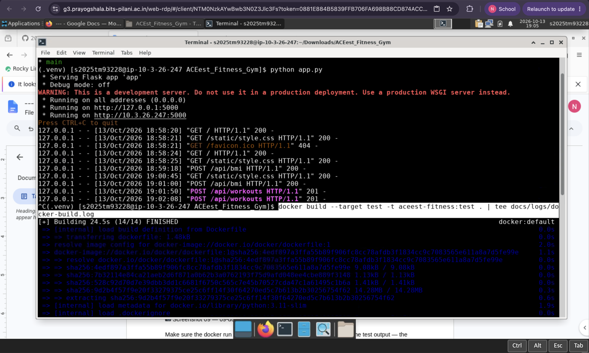
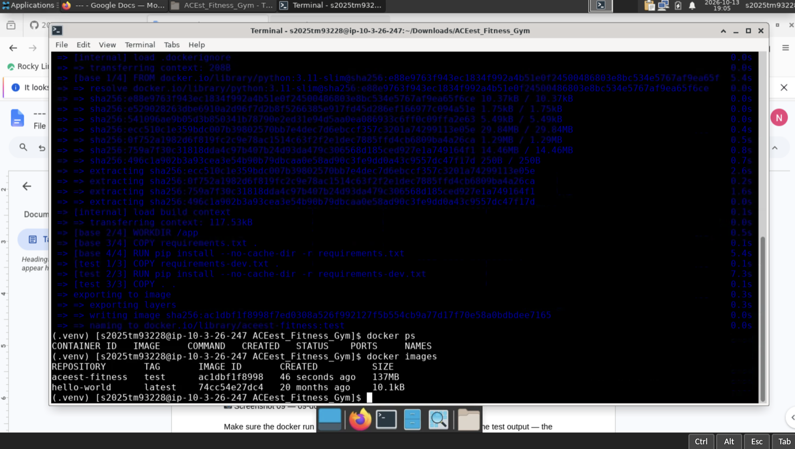
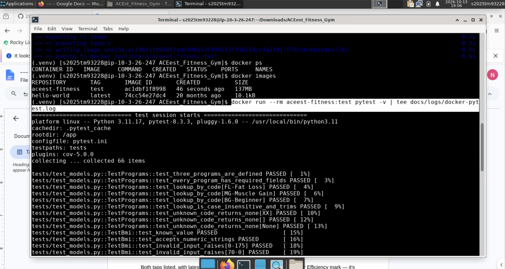
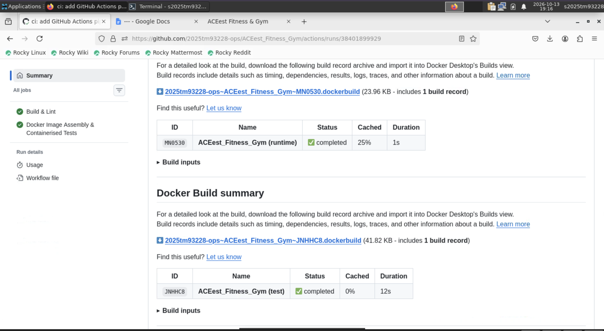
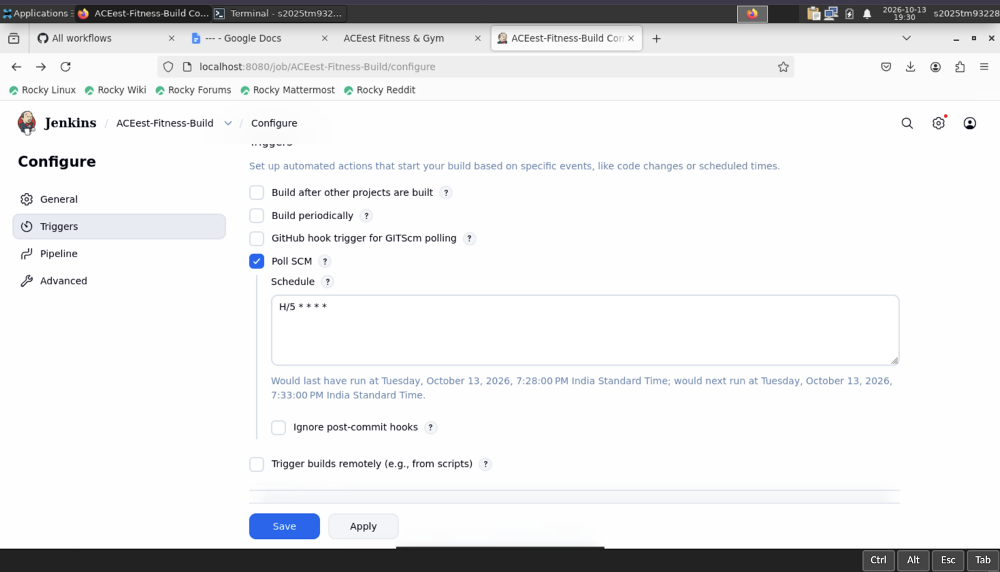
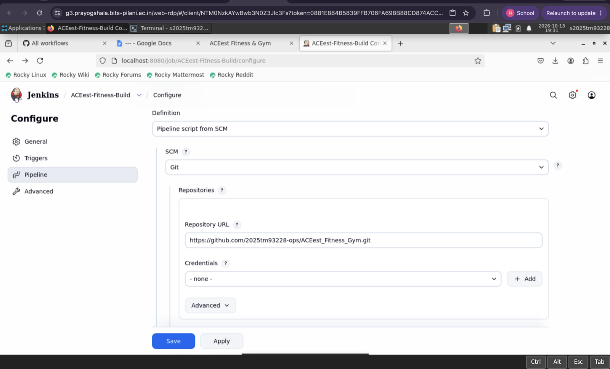
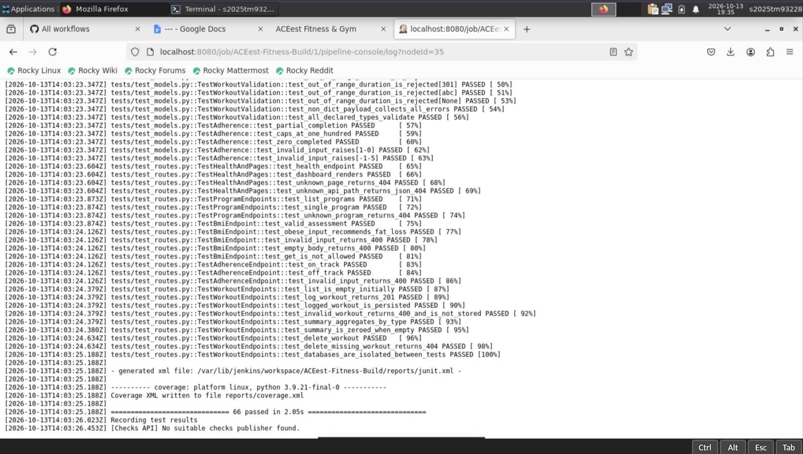
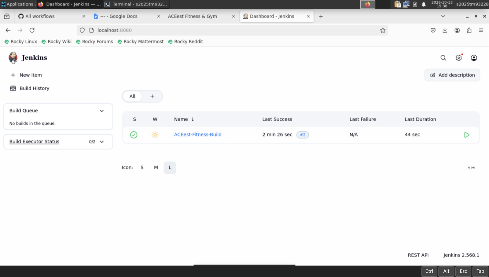

# ACEest Fitness & Gym — Automated CI/CD Pipeline

A Flask web application for **ACEest Fitness & Gym**, delivered through a fully automated
DevOps workflow: Git/GitHub for version control, Pytest for validation, Docker for
containerisation, **GitHub Actions** for continuous integration and **Jenkins** for the
controlled BUILD phase and quality gate.

The domain logic (training programmes, nutrition plans, BMI assessment, workout logging and
adherence tracking) was ported from the original ACEest Tkinter desktop prototypes into a
stateless, container-friendly web service.

| | |
|---|---|
| **Tests** | 66 passing, 99% statement coverage |
| **Container** | Multi-stage build, non-root, 131 MB runtime image |
| **GitHub Actions** | 6 runs, all green, triggered on every push |
| **Jenkins** | Builds #1 and #2 green across all 7 stages, zero failures |
| **Environment** | Rocky Linux VM · Python 3.11 · Docker · Jenkins 2.568.1 |

---

# Pipeline Evidence

All 45 screenshots from the assignment session (13 October 2026, 18:08 – 19:39 IST) are in
[`docs/screenshots/`](docs/screenshots/), numbered in capture order and named by content.

Jenkins runs at `localhost:8080` on the lab VM and is not publicly reachable, so section **F**
is the record of the BUILD quality gate completing without errors.

## A. Version Control (VCS Maturity)

| | |
|---|---|
| [`01`](docs/screenshots/01-github-repo-created-empty.png) | Public repository created |
| [`02`](docs/screenshots/02-clone-and-first-commit-attempt.png) | Clone and initial commit attempt |
| [`03`](docs/screenshots/03-push-fails-password-auth-rejected.png) | Push rejected — GitHub no longer accepts password auth; resolved with a Personal Access Token |
| [`04`](docs/screenshots/04-checkout-feature-pytest-suite-branch.png) · [`05`](docs/screenshots/05-checkout-infra-cicd-branch.png) | Feature and infrastructure branches checked out |

All four branches tracking `origin`:


Commit graph: [`docs/logs/git-history.log`](docs/logs/git-history.log) — 13 commits with three
`--no-ff` merges from `feature/pytest-suite`, `infra/docker` and `infra/cicd`.

## B. Application Integrity

Environment prepared with Python 3.11
([`07`](docs/screenshots/07-python311-virtualenv-created.png),
[`08`](docs/screenshots/08-install-dependencies-flask-pytest.png)), then `main` checked out and
the server started:


Dashboard with live gym metrics:


All three training programmes
([`13`](docs/screenshots/13-flask-training-programmes.png)) and the input forms
([`14`](docs/screenshots/14-flask-bmi-and-workout-forms.png)).

`POST /api/bmi` — 95 kg at 172 cm returns BMI 32.11, category *Obese*, recommends Fat Loss.
Browser devtools confirm **200 OK**:


`POST /api/workouts` — validated, written to SQLite, returned with its new `id`.
Devtools confirm **201 CREATED**:


Flask's own access log confirming the same requests server-side:



## C. Testing Coverage

**66 tests passed**:


Coverage **99%**, with `models.py` at 100%:


| Module | Statements | Coverage |
|---|---|---|
| `models.py` | 61 | 100% |
| `app.py` | 85 | 99% |
| `db.py` | 22 | 95% |
| **Total** | **355** | **99%** |

## D. Docker Efficiency

Multi-stage build of the `test` target:



**Pytest executing inside the container** — the `docker run --rm aceest-fitness:test pytest -v`
command is visible, confirming the suite ran in the containerised environment, not on the host:



Runtime image built ([`20`](docs/screenshots/20-docker-build-runtime-image.png)). The `runtime`
image is **smaller than `test`** — the multi-stage build keeps pytest, pytest-cov and flake8 out
of production:


| Tag | Size | Contents |
|---|---|---|
| `aceest-fitness:test` | 137 MB | app + dev dependencies |
| `aceest-fitness:latest` | 131 MB | app only, non-root, gunicorn |

Container started detached
([`22`](docs/screenshots/22-docker-run-detached-container.png)) and reporting Docker's own
`HEALTHCHECK` as **healthy**:


`/health` responding from inside the container:


## E. GitHub Actions (Continuous Integration)

Six workflow runs, all green, triggered automatically on push
([`25`](docs/screenshots/25-actions-all-workflows.png)):


Both jobs passing in sequence — `Build & Lint` gates `Docker Image Assembly & Containerised Tests`:


Docker build summary for both the `test` and `runtime` targets:



## F. Jenkins BUILD & Quality Gate

Required plugins installed — Git
([`29`](docs/screenshots/29-jenkins-git-plugin-installed.png)) and JUnit
([`30`](docs/screenshots/30-jenkins-junit-plugin-installed.png)) — then Jenkins restarted
([`31`](docs/screenshots/31-jenkins-restarting-after-plugins.png)).

Pipeline job created ([`32`](docs/screenshots/32-jenkins-new-pipeline-item.png),
[`33`](docs/screenshots/33-jenkins-job-general-config.png)).

**Poll SCM** trigger (`H/5 * * * *`) — used instead of a webhook because GitHub cannot reach a
lab VM on a private network:



**Pipeline script from SCM**, pointed at this repository and tracking `*/main`
([`35`](docs/screenshots/35-jenkins-branch-specifier-main.png)):



### Build #1 — all stages green

Job created with no builds yet
([`37`](docs/screenshots/37-jenkins-job-created-no-builds.png)), then the first build runs
([`38`](docs/screenshots/38-jenkins-build1-in-progress.png),
[`39`](docs/screenshots/39-jenkins-build1-stages-with-post-actions.png)).

Checkout SCM → Checkout → Build Environment → Lint & Compile → Unit Tests (Quality Gate)
→ Docker Build → Container Smoke Test. Completed in 1 min 8 sec:


Console log — **66 passed**, with `junit.xml` and `coverage.xml` written to the workspace:



### JUnit results published

Test Result Trend after build #1
([`42`](docs/screenshots/42-jenkins-test-trend-after-build1.png)), then across builds #1 and #2
— both 66 passing, no failures:


### Build #2 — repeatable

Job dashboard showing **Last Success #2, Last Failure: N/A**:



Build #2 succeeded in 44 sec against revision `1b0aedb`, `Tests (no failures)`:


## Evidence summary

| Evaluation criterion | Evidence |
|---|---|
| Application Integrity | §B — dashboard, `200 OK` on BMI, `201 CREATED` on workout write |
| VCS Maturity | §A — 13 commits, 4 branches, 3 `--no-ff` merges |
| Testing Coverage | §C — 66 tests, 99% statement coverage |
| Docker Efficiency | §D — multi-stage, non-root, runtime smaller than test image |
| Pipeline Reliability (GitHub Actions) | §E — 6 green runs triggered on push |
| Pipeline Reliability (Jenkins) | §F — builds #1 and #2 green across all 7 stages, zero failures |

---

# Documentation

## 1. Architecture

```
┌──────────────┐   git push    ┌──────────────┐
│  Developer   │──────────────▶│    GitHub    │
└──────────────┘               └──────┬───────┘
                                      │
                 ┌────────────────────┴────────────────────┐
                 │                                         │
        ┌────────▼─────────┐                     ┌─────────▼────────┐
        │  GitHub Actions  │                     │     Jenkins      │
        │  (CI on push/PR) │                     │  (BUILD + gate)  │
        ├──────────────────┤                     ├──────────────────┤
        │ 1 Build & Lint   │                     │ 1 Checkout       │
        │ 2 Pytest         │                     │ 2 Clean venv     │
        │ 3 Docker build   │                     │ 3 Lint & compile │
        │ 4 Pytest in      │                     │ 4 Pytest + JUnit │
        │   container      │                     │ 5 Docker build   │
        │ 5 Smoke test     │                     │ 6 Smoke test     │
        └──────────────────┘                     └──────────────────┘
```

### Project layout

| Path | Purpose |
|---|---|
| `app.py` | Flask application factory, routes, error handlers |
| `models.py` | Pure domain logic — no Flask imports, unit-tested in isolation |
| `db.py` | SQLite persistence bound to the Flask request lifecycle |
| `templates/`, `static/` | Server-rendered dashboard |
| `tests/` | Pytest suite (`conftest.py`, `test_models.py`, `test_routes.py`) |
| `Dockerfile` | Multi-stage build: `base` → `test` → `runtime` |
| `.github/workflows/main.yml` | GitHub Actions CI/CD pipeline |
| `Jenkinsfile` | Declarative Jenkins BUILD pipeline |
| `docs/screenshots/` | Pipeline evidence (45 images) |
| `docs/logs/` | Raw command output committed as text evidence |

## 2. Local setup and execution

**Prerequisites:** Python 3.11+, Git, Docker.

```bash
git clone https://github.com/2025tm93228-ops/ACEest_Fitness_Gym.git
cd ACEest_Fitness_Gym

python3.11 -m venv .venv
source .venv/bin/activate          # Windows: .venv\Scripts\activate
pip install -r requirements-dev.txt

python app.py
```

Open <http://localhost:5000>.

> **Python version matters.** Flask 3.0.3 requires Python 3.8+. Rocky Linux 8 and RHEL 8 ship
> Python 3.6 as the default `python3` — install `python3.11` and use it explicitly, or `pip
> install` will fail.

> **Port already in use?** Override it: `PORT=5055 python app.py`
> (On macOS the AirPlay Receiver occupies port 5000 by default.)

The SQLite file location is configurable via the `ACEEST_DB` environment variable
(default `aceest_fitness.db`).

### Run with Docker

```bash
docker build --target runtime -t aceest-fitness:latest .
docker run -d -p 5000:5000 --name aceest aceest-fitness:latest
curl http://localhost:5000/health

docker logs aceest
docker rm -f aceest
```

## 3. Running the tests manually

```bash
# On the host
source .venv/bin/activate
pytest -v                                      # 66 tests
pytest -v --cov=. --cov-report=term-missing    # with coverage (99%)
pytest tests/test_models.py -v                 # domain logic only
pytest -k "bmi" -v                             # filter by keyword

# Inside the container — identical to what CI executes
docker build --target test -t aceest-fitness:test .
docker run --rm aceest-fitness:test pytest -v
```

### What the suite covers

* **`test_models.py`** — programme catalogue integrity, case-insensitive lookup, unknown
  codes, BMI arithmetic and WHO category boundaries (18.5 / 25 / 30), programme
  recommendation, workout validation (required fields, allowed types, duration bounds,
  non-dict payloads) and adherence scoring including the 100% cap.
* **`test_routes.py`** — health check, dashboard rendering, JSON vs. HTML 404s, 405 on wrong
  method, programme endpoints, BMI assessment happy path and 400s, adherence endpoint,
  workout create/list/delete/summary aggregation and rejection of invalid writes.

Each test receives a **throwaway SQLite database** via the `app` fixture, so tests are
order-independent and leave no state behind.

## 4. API reference

| Method | Endpoint | Description |
|---|---|---|
| `GET` | `/` | HTML dashboard |
| `GET` | `/health` | Liveness probe used by Docker, CI and Jenkins |
| `GET` | `/api/programs` | All training programmes |
| `GET` | `/api/programs/<code>` | One programme (`FL`, `MG`, `BG`); 404 if unknown |
| `POST` | `/api/bmi` | `{"weight": 70, "height": 175}` → BMI, category, recommendation |
| `POST` | `/api/adherence` | `{"completed_sessions": 4, "planned_sessions": 5}` → % and on-track flag |
| `GET` | `/api/workouts` | List logged workouts |
| `POST` | `/api/workouts` | Log a workout → `201`, or `400` with an `errors` array |
| `GET` | `/api/workouts/summary` | Totals aggregated by workout type |
| `DELETE` | `/api/workouts/<id>` | Delete a workout; 404 if absent |

Example:

```bash
curl -X POST http://localhost:5000/api/bmi \
     -H 'Content-Type: application/json' \
     -d '{"weight": 70, "height": 175}'
# {"bmi":22.86,"category":"Normal","recommended_program":{...,"code":"BG"}}
```

## 5. Docker design notes

The `Dockerfile` uses **three stages** so that test tooling never ships to production:

1. **`base`** — `python:3.11-slim` with only `requirements.txt` installed. Requirements are
   copied *before* the source so the dependency layer stays cached across code changes.
2. **`test`** — adds `requirements-dev.txt` (pytest, flake8) and the full source tree. This
   is the target CI builds to run the suite *inside* the container.
3. **`runtime`** — copies only the application modules, templates and static assets; no
   tests, no dev dependencies, no `.git`.

Efficiency and security measures:

* slim base image, `--no-cache-dir` on every `pip install`, and a `.dockerignore`
  that excludes `.git`, `.venv`, caches and `*.db`;
* runs as the **unprivileged `aceest` user**, never root;
* `PYTHONDONTWRITEBYTECODE` / `PYTHONUNBUFFERED` for clean logs and no stray `.pyc`;
* a `HEALTHCHECK` hitting `/health`;
* **gunicorn** with two workers as the production WSGI server — not the Flask dev server.

## 6. GitHub Actions integration logic

Defined in `.github/workflows/main.yml`, triggered on **every push to any branch**, every
**pull request to `main`**, and manually via `workflow_dispatch`.

**Job 1 — `build-and-lint`**
Checks out the code, sets up Python 3.11 with pip caching, installs dependencies,
runs `python -m compileall` as a syntax gate, then `flake8` (hard-failing on the
`E9,F63,F7,F82` error classes, advisory for style), and finally the Pytest suite with coverage.

**Job 2 — `docker-build-and-test`** (`needs: build-and-lint`)
Only runs once job 1 is green, so a syntax or test failure never wastes a Docker build.
It sets up Buildx with a GitHub Actions layer cache, builds the `test` target, and
**executes `pytest -v` inside the container** — satisfying the requirement that the suite
runs in the containerised environment. It then builds the `runtime` image tagged with both
`latest` and the commit SHA, starts it, polls `/health` until it responds, asserts
`/api/programs` returns real data, and prints the final image size.

The two-job split gives fast feedback on cheap checks and keeps the expensive container
work behind a passing gate.

## 7. Jenkins integration logic

`Jenkinsfile` is a declarative pipeline representing the controlled **BUILD** phase — a
second, independent validation layer on dedicated infrastructure rather than a hosted runner.

| Stage | Action |
|---|---|
| **Checkout** | `checkout scm` pulls the latest commit from GitHub; prints the last 5 commits |
| **Build Environment** | Creates a **clean** virtualenv and installs dependencies from scratch, proving the project builds from a bare machine |
| **Lint & Compile** | `compileall` + `flake8` — the first quality gate |
| **Unit Tests** | `pytest` with `--junitxml`; the `junit` post-step publishes results to the Jenkins UI so trends are visible per build |
| **Docker Build** | Builds the `test` target, runs the suite inside it, then builds the `runtime` image tagged with `${BUILD_NUMBER}` and `latest` |
| **Container Smoke Test** | Starts the image on port 5050 and curls `/health` |

`post` blocks report success/failure and always remove the virtualenv, so each build starts clean.

**Jenkins configuration used:** a *Pipeline* job named `ACEest-Fitness-Build` with **Pipeline
script from SCM** → Git → this repository → branch `*/main` → script path `Jenkinsfile`,
triggered by **Poll SCM** (`H/5 * * * *`). Polling is used rather than a webhook because the
Jenkins host is a lab VM on a private network that GitHub cannot reach.

### Division of responsibility

GitHub Actions is the **outer CI loop** — it reacts to every push and pull request on every
branch, giving contributors immediate feedback before code is merged. Jenkins is the
**inner BUILD gate** — it rebuilds the environment from nothing on controlled
infrastructure, publishes durable JUnit test trends, and produces the build-numbered image
artefact. Running both means a regression has to pass two independently configured
toolchains, on two different machines, before it can reach a release.

## 8. Version control strategy

* `main` — protected, always green.
* `feature/*` — new functionality (e.g. `feature/pytest-suite`).
* `infra/*` — Docker, Jenkins and GitHub Actions changes.

Commits follow the **Conventional Commits** convention (`feat:`, `fix:`, `test:`, `ci:`,
`docs:`, `chore:`) so history reads as a changelog. Feature branches merge into `main`
through `--no-ff` merges, which the GitHub Actions workflow validates automatically.

## 9. Troubleshooting

| Symptom | Fix |
|---|---|
| `pip install` fails on Flask 3.0.3 | Default `python3` is older than 3.8 — use `python3.11 -m venv .venv` |
| `Address already in use` on 5000 | `PORT=5055 python app.py`; on macOS disable AirPlay Receiver |
| `docker: permission denied` | `sudo usermod -aG docker $USER`, then `newgrp docker` |
| Jenkins cannot run `docker` | `sudo usermod -aG docker jenkins && sudo systemctl restart jenkins` |
| `ModuleNotFoundError: flask` | Activate the venv: `source .venv/bin/activate` |
| Jenkins `Couldn't find any revision to build` | Branch Specifier must be `*/main`, not `*/master` |
| Tests pass locally, fail in CI | Reproduce the CI environment: `docker run --rm aceest-fitness:test pytest -v` |

## 10. Author

Submitted for **Introduction to DevOps (CSIZG514 / SEZG514)**, Assignment 1, S1-2026.
