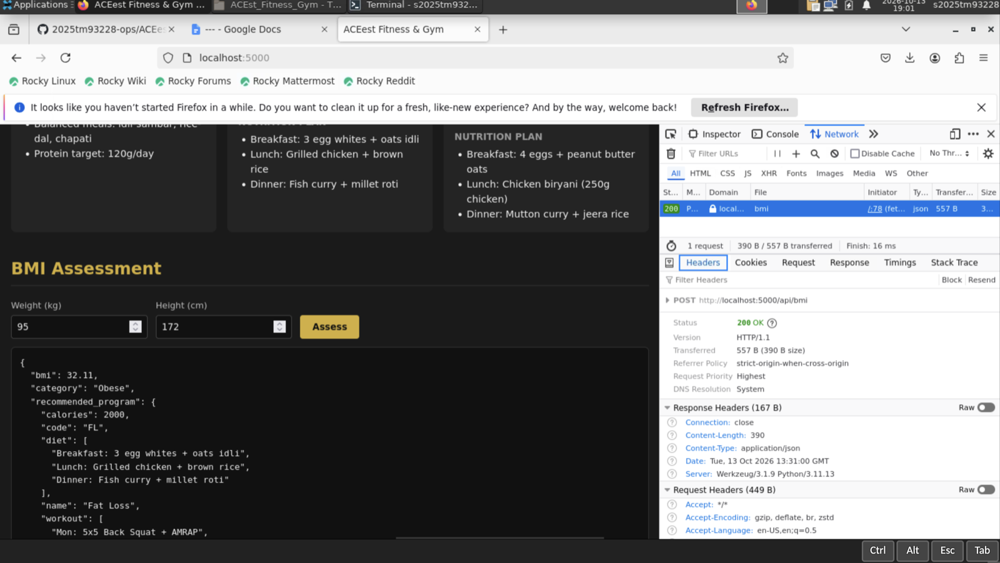
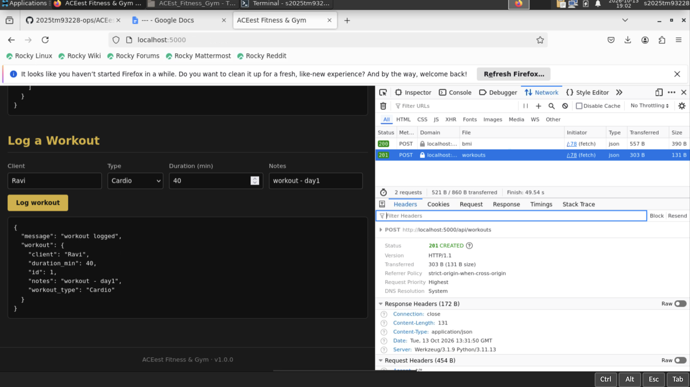
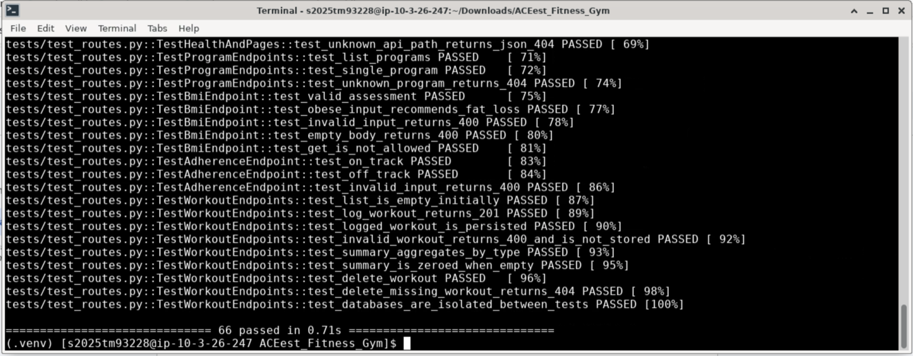
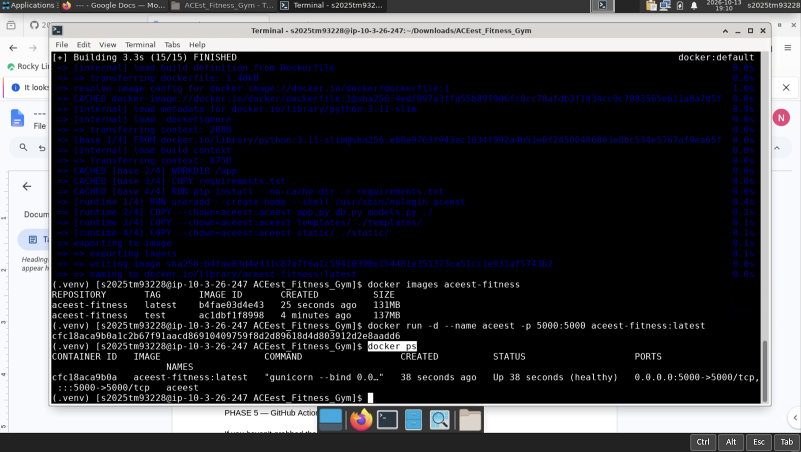
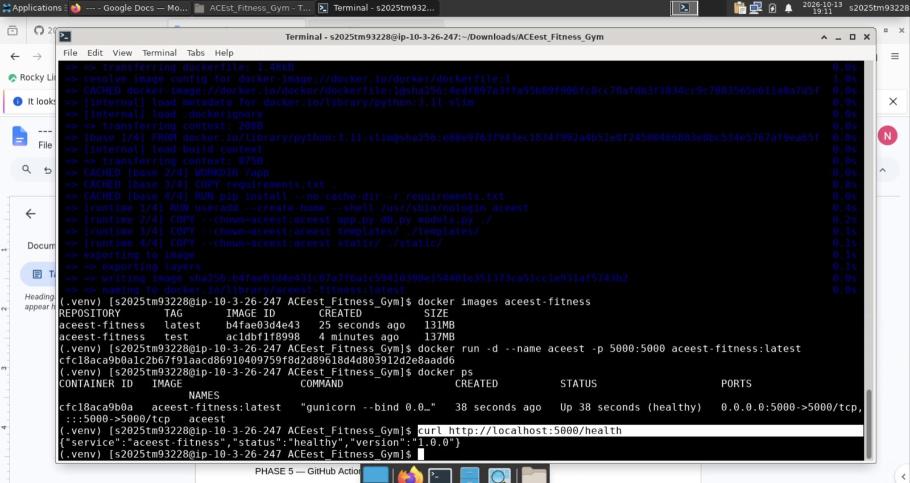
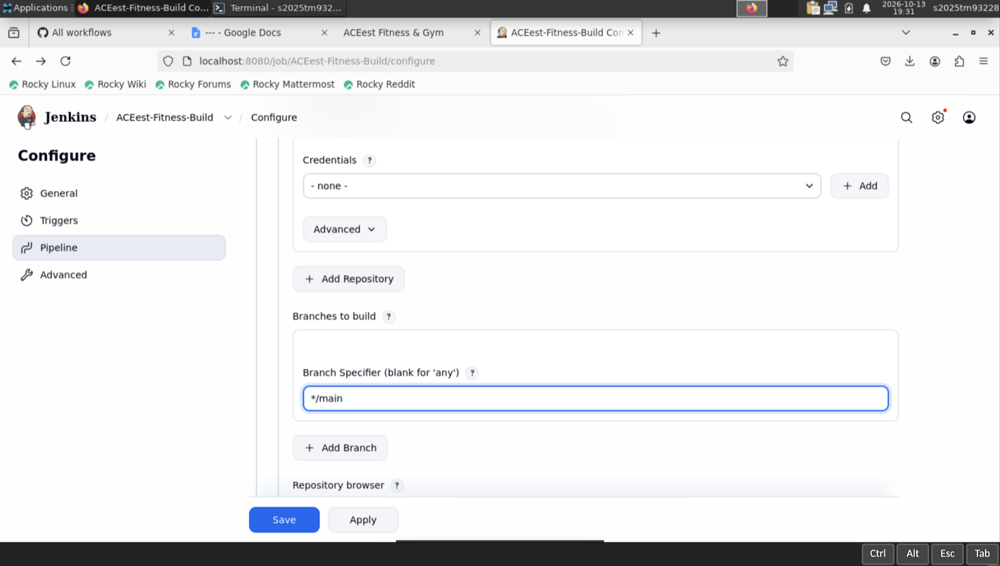
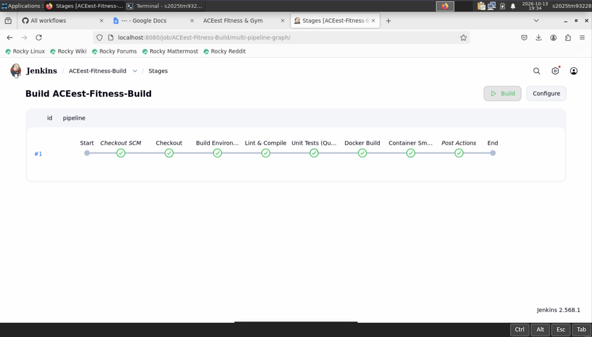
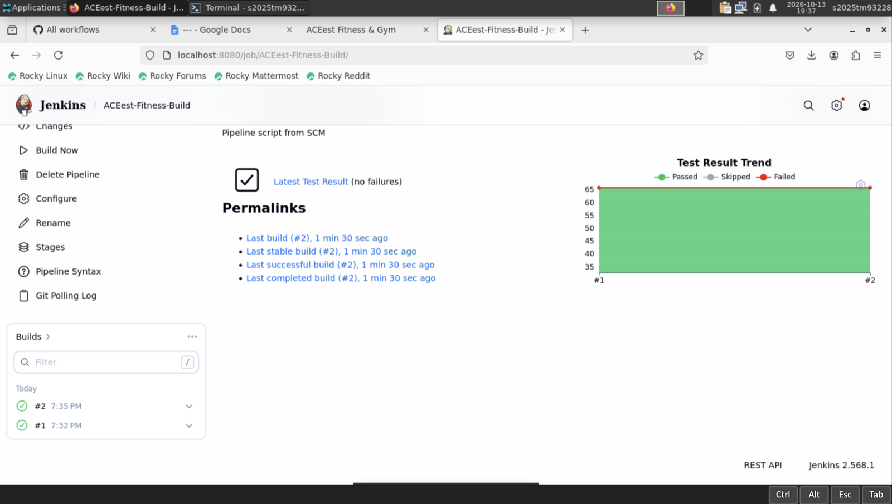

# Pipeline Evidence

Visual proof that every stage of the ACEest Fitness & Gym DevOps pipeline executed
successfully on the target environment (Rocky Linux VM, Python 3.11, Jenkins 2.568.1).

Jenkins runs on a local lab VM at `localhost:8080` and is not publicly reachable, so the
screenshots in section **F** are the record of the BUILD stage completing without errors.

---

## A. Version Control (VCS Maturity)

All four branches cloned and tracking `origin`, with `main` checked out for the build.

The commit graph is in [`logs/git-history.log`](logs/git-history.log) — 13 commits with three
`--no-ff` merges from `feature/pytest-suite`, `infra/docker` and `infra/cicd`.

---

## B. Application Integrity

Flask development server starting on `main`:

Dashboard rendering with live gym metrics:

All three training programmes with workout and nutrition plans:

`POST /api/bmi` — 95 kg at 172 cm returns BMI 32.11, category *Obese*, and correctly
recommends the Fat Loss programme. Browser devtools confirm **200 OK**:

`POST /api/workouts` — a workout is validated, written to SQLite and returned with its new
`id`. Devtools confirm **201 CREATED**:

---

## C. Testing Coverage

Full suite green — **66 tests passed**:

Coverage report — **99%** of statements, with `models.py` at 100%:

| Module | Statements | Coverage |
|---|---|---|
| `models.py` | 61 | 100% |
| `app.py` | 85 | 99% |
| `db.py` | 22 | 95% |
| **Total** | **355** | **99%** |

Raw output: [`logs/pytest.log`](logs/pytest.log) · [`logs/pytest-coverage.log`](logs/pytest-coverage.log)

---

## D. Docker Efficiency

Multi-stage build of the `test` target:

**Pytest executing inside the container** — the `docker run --rm aceest-fitness:test pytest -v`
command is visible, confirming the suite ran in the containerised environment rather than on
the host:

Both image tags built. The `runtime` image is **smaller than `test`** because the multi-stage
build keeps pytest, pytest-cov and flake8 out of production:

| Tag | Size | Contents |
|---|---|---|
| `aceest-fitness:test` | 137 MB | app + dev dependencies (pytest, flake8) |
| `aceest-fitness:latest` | 131 MB | app only, non-root, gunicorn |

Container running under gunicorn, reporting Docker's own `HEALTHCHECK` as **healthy**:

The `/health` endpoint responding from inside the container:

---

## E. GitHub Actions (Continuous Integration)

Six workflow runs, all green, triggered automatically by pushes to `main` and `infra/cicd`:

Both jobs passing in sequence — `Build & Lint` gates `Docker Image Assembly & Containerised Tests`:

Docker build summary for both the `test` and `runtime` targets:

---

## F. Jenkins BUILD & Quality Gate

**Poll SCM** trigger configured (`H/5 * * * *`) — used instead of a webhook because GitHub
cannot reach a lab VM on a private network:

**Pipeline script from SCM**, tracking `*/main` of this repository:

### Build #1 — all stages green

Checkout SCM → Checkout → Build Environment → Lint & Compile → Unit Tests (Quality Gate)
→ Docker Build → Container Smoke Test. Completed in 1 min 8 sec:

Stage view including Post Actions:

Pipeline console log — **66 passed**, with `junit.xml` and `coverage.xml` written to the
Jenkins workspace:

### JUnit results published to Jenkins

Test Result Trend across builds #1 and #2, both reporting 66 passing tests and no failures:

### Build #2 — repeatable

Build #2 succeeded in 44 sec against revision `1b0aedb`, with `Tests (no failures)`:

Job dashboard — **Last Success #2, Last Failure: N/A**:

---

## Summary

| Evaluation criterion | Evidence |
|---|---|
| Application Integrity | §B — dashboard rendering, `200 OK` on BMI, `201 CREATED` on workout write |
| VCS Maturity | §A — 13 commits, 4 branches, 3 `--no-ff` merges |
| Testing Coverage | §C — 66 tests, 99% statement coverage |
| Docker Efficiency | §D — multi-stage, non-root, runtime image smaller than test image |
| Pipeline Reliability (GitHub Actions) | §E — 6 green runs triggered on push |
| Pipeline Reliability (Jenkins) | §F — builds #1 and #2 green across all 7 stages, zero failures |
