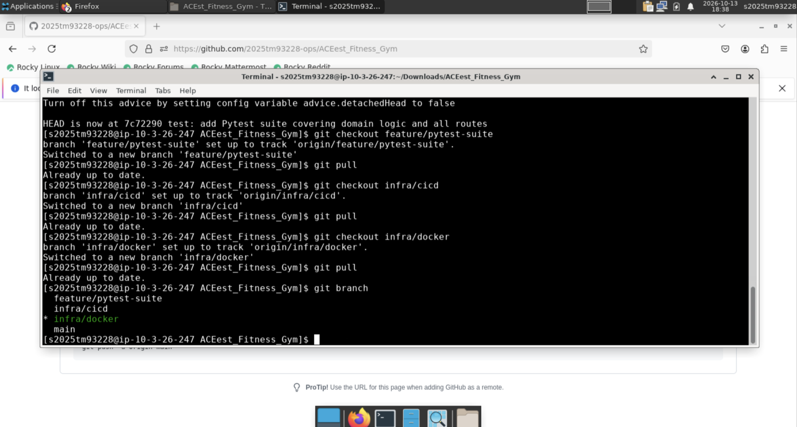
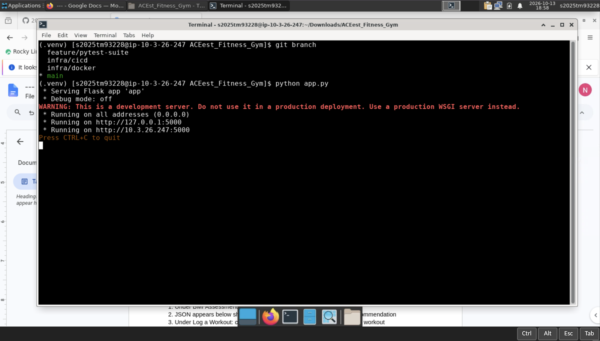
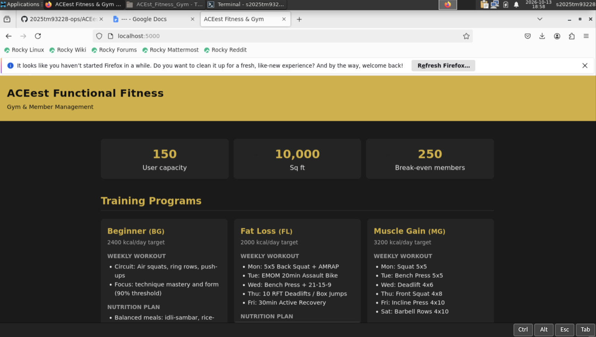
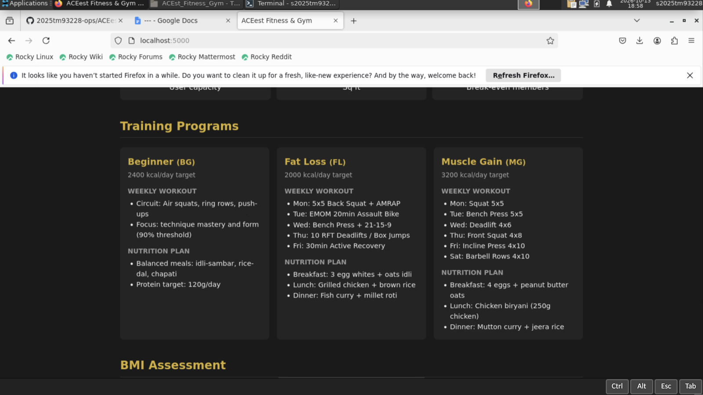
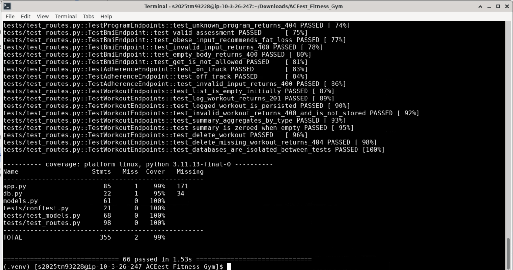
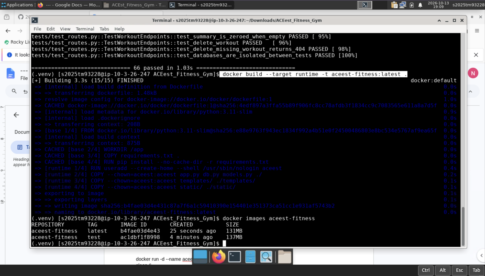
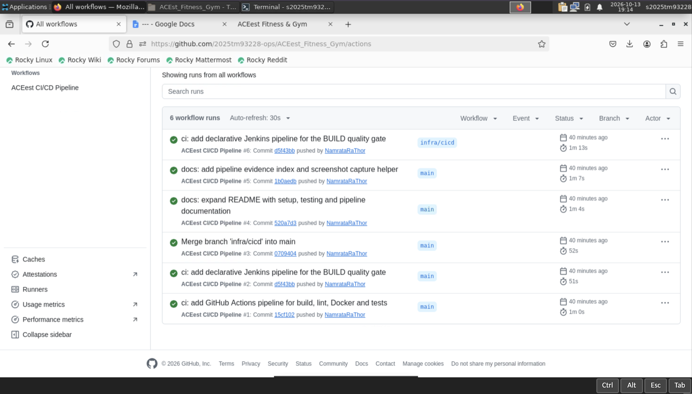
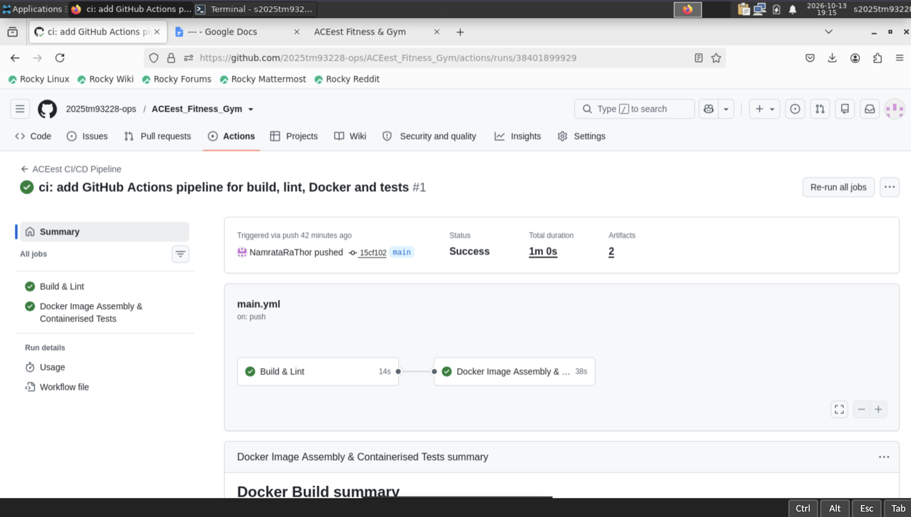
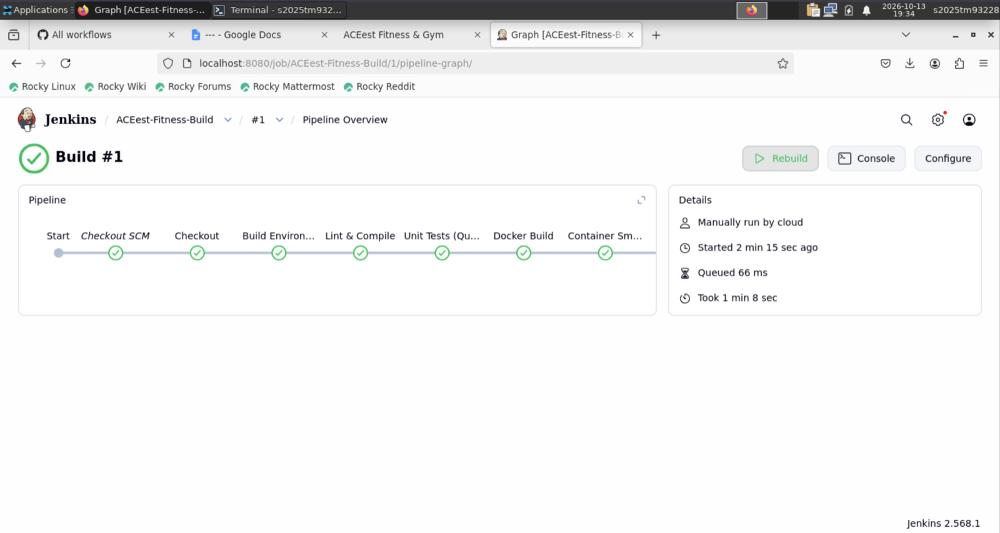
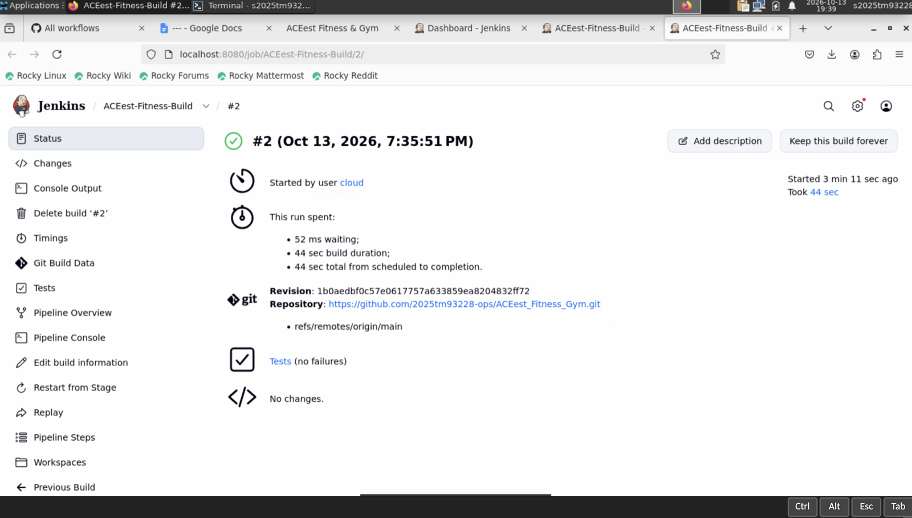

# Pipeline Evidence

All 45 screenshots from the assignment session (13 October 2026, 18:08 – 19:39 IST) on the
Rocky Linux lab VM — Python 3.11, Docker, Jenkins 2.568.1. Files are in
[`screenshots/`](screenshots/), named chronologically by capture time.

Jenkins runs at `localhost:8080` on the lab VM and is not publicly reachable, so section **F**
is the record of the BUILD quality gate completing without errors.

---

## A. Version Control (VCS Maturity)

All four branches cloned and tracking `origin`:

`main` checked out, Flask server starting:

Commit graph: [`logs/git-history.log`](logs/git-history.log) — 13 commits, three `--no-ff`
merges from `feature/pytest-suite`, `infra/docker` and `infra/cicd`.

---

## B. Application Integrity

Dashboard with live gym metrics:

All three training programmes with workout and nutrition plans:

`POST /api/bmi` — 95 kg at 172 cm returns BMI 32.11, category *Obese*, recommends Fat Loss.
Devtools confirm **200 OK**:

`POST /api/workouts` — validated, written to SQLite, returned with its new `id`.
Devtools confirm **201 CREATED**:

---

## C. Testing Coverage

**66 tests passed**:

Coverage **99%**, with `models.py` at 100%:

| Module | Statements | Coverage |
|---|---|---|
| `models.py` | 61 | 100% |
| `app.py` | 85 | 99% |
| `db.py` | 22 | 95% |
| **Total** | **355** | **99%** |

Raw output: [`logs/pytest.log`](logs/pytest.log) · [`logs/pytest-coverage.log`](logs/pytest-coverage.log)

---

## D. Docker Efficiency

Multi-stage build of the `test` target:

**Pytest executing inside the container** — the `docker run --rm aceest-fitness:test pytest -v`
command is visible, confirming the suite ran in the containerised environment, not on the host:

The `runtime` image is **smaller than `test`** — the multi-stage build keeps pytest, pytest-cov
and flake8 out of production:

| Tag | Size | Contents |
|---|---|---|
| `aceest-fitness:test` | 137 MB | app + dev dependencies |
| `aceest-fitness:latest` | 131 MB | app only, non-root, gunicorn |

Container under gunicorn, Docker's own `HEALTHCHECK` reporting **healthy**:

`/health` responding from inside the container:

---

## E. GitHub Actions (Continuous Integration)

Six workflow runs, all green, triggered automatically on push:

Both jobs passing in sequence — `Build & Lint` gates `Docker Image Assembly & Containerised Tests`:

Docker build summary for both the `test` and `runtime` targets:

---

## F. Jenkins BUILD & Quality Gate

**Poll SCM** trigger (`H/5 * * * *`) — used instead of a webhook because GitHub cannot reach a
lab VM on a private network:

**Pipeline script from SCM**, tracking `*/main`:

### Build #1 — all stages green

Checkout SCM → Checkout → Build Environment → Lint & Compile → Unit Tests (Quality Gate)
→ Docker Build → Container Smoke Test. Completed in 1 min 8 sec:

Stage view including Post Actions:

Console log — **66 passed**, with `junit.xml` and `coverage.xml` written to the workspace:

### JUnit results published

Test Result Trend across builds #1 and #2, both 66 passing, no failures:

### Build #2 — repeatable

Succeeded in 44 sec against revision `1b0aedb`, `Tests (no failures)`:

Job dashboard — **Last Success #2, Last Failure: N/A**:

---

## Session timeline

The remaining screenshots cover setup and intermediate states:

| Time | Files | Phase |
|---|---|---|
| 18:08–18:10 | `01`–`03` | Repository creation; first push attempt (auth failure, resolved with a PAT) |
| 18:37–18:39 | `04`–`06` | Cloning; checking out all four branches |
| 18:50–18:52 | `07`–`10` | Python 3.11 virtualenv, dependencies, Pytest, coverage |
| 18:58–19:02 | `11`–`16` | Flask server, dashboard, programmes, BMI and workout APIs |
| 19:05–19:11 | `17`–`24` | Multi-stage Docker build, Pytest in container, image sizes, health |
| 19:13–19:16 | `25`–`28` | GitHub Actions runs and job detail |
| 19:23–19:31 | `29`–`36` | Jenkins startup, plugin install, job configuration |
| 19:32–19:39 | `37`–`45` | Jenkins builds #1 and #2 — stages, console, JUnit trend |

---

## Summary

| Evaluation criterion | Evidence |
|---|---|
| Application Integrity | §B — dashboard, `200 OK` on BMI, `201 CREATED` on workout write |
| VCS Maturity | §A — 13 commits, 4 branches, 3 `--no-ff` merges |
| Testing Coverage | §C — 66 tests, 99% statement coverage |
| Docker Efficiency | §D — multi-stage, non-root, runtime smaller than test image |
| Pipeline Reliability (GitHub Actions) | §E — 6 green runs triggered on push |
| Pipeline Reliability (Jenkins) | §F — builds #1 and #2 green across all 7 stages, zero failures |
